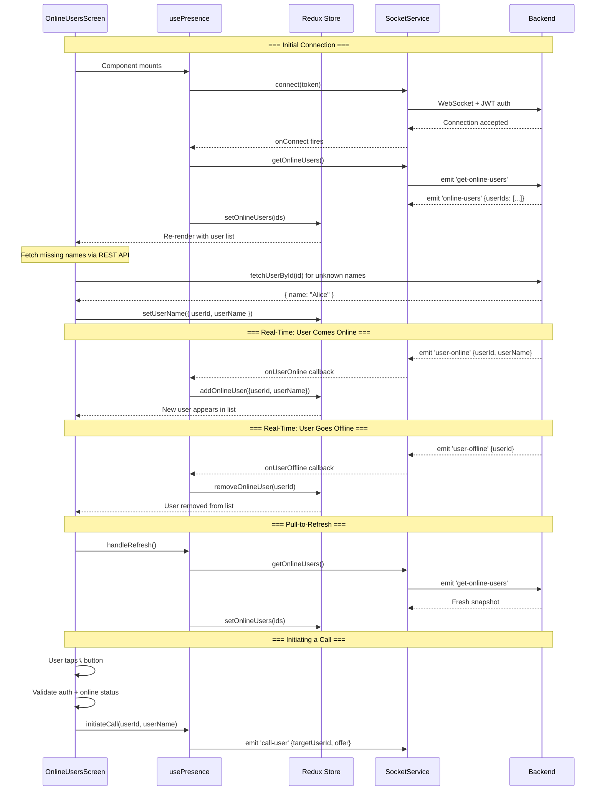

# Online Users — Real-Time Presence System

## Overview

The Online Users feature lets any authenticated user see who else is currently using the app in real time. It powers the **OnlineUsersScreen** where users can browse online peers and initiate video calls. The system is entirely **event-driven** — no polling — built on Socket.IO WebSockets and Redux state management.

---

## How It Works (Step by Step)

### Step 1 — Socket Connection & User Registration

When a user logs in and the app mounts, the `useVideoCall` hook triggers the socket lifecycle:

```
useVideoCall mount
  → socketService.connect(token)         // opens WebSocket to backend
  → socketService.registerUser({userId}) // tells server "I am user X"
```

- **`connect(token)`** opens a persistent WebSocket to `API_BASE_URL` (from `.env`), passing the JWT in the handshake (`auth: { token }`)
- **`registerUser({ userId })`** emits `register-user` so the backend maps `socket.id → userId` and adds the user to its online set
- The backend then **broadcasts `user-online`** to all other connected clients

**File:** `src/modules/video-call/hooks/useVideoCall.ts` (lines 87–113)  
**File:** `src/modules/video-call/services/socket.service.ts` (lines 62–99)

### Step 2 — Presence Listeners Setup

Simultaneously, the `usePresence` hook registers Socket.IO listeners on the **same singleton socket**:

| Socket Event | Handler | Redux Action |
|---|---|---|
| `connect` | Request online users snapshot | `setConnectionStatus('connected')` + `getOnlineUsers()` |
| `disconnect` | Update status, store reason | `setConnectionStatus('disconnected')` |
| `connect_error` | Store error message | `setConnectionStatus('disconnected')` + `setError(msg)` |
| `reconnect` | Re-sync online users | `setConnectionStatus('connected')` + `getOnlineUsers()` |
| `user-online` | Add user to Set | `addOnlineUser({ userId, userName })` |
| `user-offline` | Remove user from Set | `removeOnlineUser(userId)` |
| `online-users` | Replace entire Set | `setOnlineUsers(userIds)` |

**File:** `src/modules/video-call/hooks/usePresence.ts`

### Step 3 — Initial Online Users Snapshot

On first connection (and every reconnection), the hook automatically requests the full list:

```
Client emits:    'get-online-users'  {}
Server responds: 'online-users'     { userIds: ["id1", "id2", "id3"] }
```

The `setOnlineUsers` reducer replaces the entire `Set<string>` in Redux, ensuring the client is in sync with the server's truth.

### Step 4 — Real-Time Updates

After the initial snapshot, the server pushes incremental updates:

- **User comes online** → server broadcasts `user-online { userId, userName? }` → `addOnlineUser` adds to Set
- **User goes offline** → server broadcasts `user-offline { userId }` → `removeOnlineUser` deletes from Set

No re-fetching the full list — just surgical add/remove operations.

### Step 5 — Name Resolution

The `online-users` snapshot only contains IDs (no names). The `OnlineUsersScreen` fills in names:

```typescript
// For each userId without a stored name:
const user = await fetchUserById(userId);  // REST API call
dispatch(setUserName({ userId, userName: user.name }));
```

For `user-online` events, the server may include `userName` directly, avoiding the extra API call.

**File:** `src/screens/OnlineUsersScreen.tsx` (lines 45–51)

### Step 6 — UI Rendering

`OnlineUsersScreen` consumes Redux state via `usePresence()` and renders:

- **Header**: shows total online count
- **FlatList**: one row per online user (excluding current user) with avatar, name, green dot, and call button
- **Pull-to-refresh**: manually re-emits `get-online-users`
- **Empty state**: contextual message (waiting for connection / no users online)
- **Loading overlay**: shown during initial data fetch

### Step 7 — Initiating a Call

When the user taps the 📞 button:

1. Validates the user is authenticated
2. Checks the target user is still online
3. Calls `initiateCall(userId, userName)` from `useVideoCall`
4. Navigation moves to the outgoing call screen

---

## How the Backend Knows a User is Online/Offline

### Online Detection
```
1. Client opens WebSocket  →  Server validates JWT in handshake middleware
2. Client emits 'register-user' { userId }  →  Server maps socket.id → userId
3. Server adds userId to online set  →  Broadcasts 'user-online' to others
```

### Offline Detection
```
- App closed/killed     → TCP connection drops instantly → Server 'disconnect' event
- Network lost          → Socket.IO heartbeat timeout (~25s) → Server 'disconnect' event
- Explicit disconnect   → socket.disconnect() → Immediate server notification
```

On disconnect, the server removes the userId from its online set and broadcasts `user-offline` to all remaining clients.

---

## Architecture Diagram

```
┌─────────────────────────────────────────────────────────────────┐
│                        OnlineUsersScreen                        │
│  FlatList · Pull-to-refresh · Call buttons · Empty/Loading UI   │
├─────────────────────────────────────────────────────────────────┤
│                         usePresence Hook                        │
│  Sets up socket listeners → Dispatches Redux actions            │
│  Returns: onlineUserIds, onlineCount, isConnected, error, etc.  │
├───────────────────────────┬─────────────────────────────────────┤
│    presenceSlice (Redux)  │       presenceSelectors             │
│  onlineUserIds: Set       │  selectOnlineUserIds → Array        │
│  userNames: Record        │  selectOnlineUserCount → number     │
│  connectionStatus         │  selectIsUserOnline → boolean       │
│  error, lastSyncTime      │  selectIsConnected → boolean        │
├───────────────────────────┴─────────────────────────────────────┤
│                   SocketService (Singleton)                      │
│  Shared by usePresence + useVideoCall                           │
│  connect() · registerUser() · getOnlineUsers()                  │
│  Listens: user-online · user-offline · online-users             │
├─────────────────────────────────────────────────────────────────┤
│                   Backend Server (Socket.IO)                     │
│  JWT auth middleware · Online user tracking · Event broadcasting │
└─────────────────────────────────────────────────────────────────┘
```

## Workflow Diagram



---

## Socket Events Reference

### Client → Server

| Event | Payload | Description |
|---|---|---|
| `register-user` | `{ userId }` | Register this socket as a specific user |
| `get-online-users` | `{}` | Request full snapshot of online users |

### Server → Client

| Event | Payload | Description |
|---|---|---|
| `registered` | `{ message }` | Confirm registration succeeded |
| `online-users` | `{ userIds: string[] }` | Full snapshot of online user IDs |
| `user-online` | `{ userId, userName? }` | A user just came online |
| `user-offline` | `{ userId }` | A user just went offline |

---

## Redux State Shape

```typescript
interface PresenceState {
  onlineUserIds: Set<string>;              // O(1) add/remove/lookup
  userNames: Record<string, string>;       // userId → display name
  connectionStatus: 'connecting' | 'connected' | 'reconnecting' | 'disconnected';
  isLoading: boolean;
  error: string | null;
  lastSyncTime: number | null;             // timestamp of last server sync
}
```

### Actions

| Action | Payload | Purpose |
|---|---|---|
| `setOnlineUsers` | `string[]` | Replace entire set (server snapshot) |
| `addOnlineUser` | `{ userId, userName? }` | Add single user |
| `removeOnlineUser` | `string` | Remove single user |
| `setUserName` | `{ userId, userName }` | Store fetched display name |
| `setConnectionStatus` | `ConnectionStatus` | Update connection state |
| `setError` | `string \| null` | Set/clear error message |
| `clearOnlineUsers` | — | Empty the online set |
| `resetPresence` | — | Reset to initial state |

### Selectors

| Selector | Returns | Description |
|---|---|---|
| `selectOnlineUserIds` | `string[]` | Array of online user IDs |
| `selectOnlineUserCount` | `number` | Count of online users |
| `selectIsConnected` | `boolean` | Whether socket is connected |
| `selectIsUserOnline` | `boolean` | Check specific user's status |
| `selectUserNames` | `Record<string,string>` | All stored display names |
| `selectError` | `string \| null` | Current error message |

---

## File Map

| File | Purpose |
|---|---|
| `src/screens/OnlineUsersScreen.tsx` | UI — user list, call buttons, pull-to-refresh |
| `src/modules/video-call/hooks/usePresence.ts` | Hook — wires socket events to Redux |
| `src/modules/video-call/hooks/useVideoCall.ts` | Hook — socket connect + user registration |
| `src/modules/video-call/services/socket.service.ts` | Singleton — Socket.IO client wrapper |
| `src/modules/video-call/store/presenceSlice.ts` | Redux — state, reducers, actions |
| `src/modules/video-call/store/presenceSelectors.ts` | Redux — memoized selectors |
| `src/modules/video-call/constants/videoCallEvents.ts` | Constants — event name strings |
| `src/modules/video-call/types/socket.types.ts` | TypeScript — event payload types |

---

## Usage Examples

### Show Online Count
```typescript
const { onlineCount } = usePresence();
// → "3 users online"
```

### Check If Specific User is Online
```typescript
const isOnline = useSelector(state => selectIsUserOnline(state, userId));
// → true / false
```

### Manual Refresh
```typescript
const { getOnlineUsers } = usePresence();
getOnlineUsers(); // re-emits 'get-online-users' to server
```

---

## Key Design Decisions

1. **Singleton socket** — `usePresence` and `useVideoCall` share one socket instance. Neither clears all listeners on unmount to avoid breaking the other.

2. **Set-based storage** — `onlineUserIds` uses `Set<string>` for O(1) add/remove/lookup instead of array scanning.

3. **Event-driven, not polling** — Real-time updates via `user-online`/`user-offline` events. Full snapshot only on connect/reconnect.

4. **Lazy name resolution** — The snapshot sends only IDs. Names are fetched via REST API only for users missing from the `userNames` cache.

5. **Auto-reconnection** — Socket.IO reconnects with exponential backoff. On reconnect, the hook automatically re-syncs the online users list.