# Story Feature Architecture & Codebase Design

This document details the architecture, file structure, state management, gesture handlers, native integrations, and workflow pipelines of the Instagram-style **Story Feature** within the application.

---

## 🗺️ System Interaction & Flow Diagram

The following diagram illustrates how the components, hooks, native modules, and local storage interact during the story lifecycle.

```mermaid
sequenceDiagram
    participant User as User
    participant LS as StoryList (Feed Screen)
    participant Cam as CameraScreen
    participant Ed as EditStoryScreen
    participant Canvas as StoryCanvas
    participant TextItem as AnimatedTextItem
    participant GifPicker as GifPickerModal
    participant GifSticker as GifSticker (Canvas Overlay)
    participant Store as storyStorage (AsyncStorage)
    participant Modal as StoryModal
    participant Native as NativeModules (AudioPicker/ImageSaver)

    User->>LS: Taps "+" Create Story Button
    LS->>Cam: Navigation.navigate('Camera')
    Cam->>Native: Direct Camera Permission Request
    Native-->>Cam: Permission Granted
    Cam->>Native: Capture Image / Pick from Gallery
    Native-->>Cam: Returns Image Asset (URI)
    Cam->>Ed: Navigate with Image URI
    
    rect rgb(25, 25, 25)
        note right of Ed: Edit Canvas Session
        Ed->>Ed: Apply ColorMatrix Filters
        Ed->>TextItem: Add Draggable/Animated Text Sticker
        Ed->>Native: Search and Select Music Track
        Native-->>Ed: Play track & Add Music Sticker to Canvas
        TextItem->>TextItem: Touch Gestures (Drag, Pinch Zoom, Rotate)
        TextItem->>Ed: Update sticker state (onUpdate)
        User->>TextItem: Taps "✕" Delete Button on Selected Music Sticker
        TextItem->>Ed: onDelete() -> Stops Native Audio & Clears Sticker
        Ed->>Ed: Tap Location Button -> LocationSearchModal
        Ed->>Canvas: Adds Location Sticker Overlay
        Ed->>GifPicker: Tap GIF Button -> GifPickerModal Opens
        GifPicker->>GifPicker: Load Trending / Search GIPHY
        User->>GifPicker: Taps a GIF Sticker
        GifPicker->>Canvas: Adds GifSticker Overlay
        GifSticker->>GifSticker: Touch Gestures (Drag, Pinch, Rotate)
        GifSticker->>Ed: Commits position update onGestureEnd
    end

    User->>Ed: Taps "Save" to export Story
    Ed->>Ed: setSelectedTextId(null) — clears selection borders/badges
    Ed->>Ed: awaits 80ms frame — React re-renders clean canvas state
    Ed->>Native: ViewShot.capture() -> Generates flattened JPG
    Ed->>Store: Saves UserStory (Image, Filter, Audio, GIF Stickers, timestamp)
    Ed->>LS: Navigates Back to Feed Screen
    LS->>Store: Retrieves latest stories list
    LS-->>User: Renders user avatar with active border

    User->>LS: Taps User Avatar bubble
    LS->>Modal: Opens Story Viewer Modal
    Modal->>Native: Plays background audio track
    Modal->>Modal: Renders StoryTextOverlay (TextLayers + GIF Stickers)
    Modal->>Modal: Auto-swipes next story every 10 seconds
    User->>Modal: Swipes down to Close (PanResponder)
    Modal->>Native: Stops background audio
```



---

## 📂 File Structure Directory & Responsibilities

The Story Feature is modularized across screens, components, custom hooks, storage adapters, services, and native utilities:

```
src/
├── components/
│   ├── CreateStoryButton.tsx      # Entry point button for creating a new story from the story tray.
│   ├── StoryList.tsx              # Horizontal story tray; onViewableItemsChanged for offscreen optimization.
│   ├── StoryItem.tsx              # Individual story avatar bubble with active indicator borders.
│   ├── StoryModal.tsx             # Fullscreen story viewer with timer, swipe-to-close, download, and interactive overlays.
│   ├── story/                     # Story editor and playback UI
│   │   ├── StoryCanvas.tsx        # Canvas container for background image, filters, and overlayed stickers.
│   │   ├── StoryTextOverlay.tsx   # Read-only playback renderer for text layers and GIF stickers.
│   │   ├── StoryPreview.tsx       # Image/video preview renderer used during playback and capture.
│   │   ├── StoryProgressBar.tsx   # Visual progress bar for story playback.
│   │   ├── FontPresetSelector.tsx # Typography preset picker for story text styling.
│   │   ├── TextToolbar.tsx        # Text controls for alignment, color, background, and animation.
│   │   ├── TextEditorModal.tsx    # Modal input for adding or editing story text.
│   │   ├── DraggableText.tsx      # Gesture-enabled text sticker wrapper used by the editor canvas.
│   │   └── StoryVideoPlayer.tsx   # Video/audio playback wrapper used for story preview and viewer.
│   ├── text/
│   │   ├── AnimatedTextItem.tsx   # Gesture-driven text sticker supporting pan/pinch/rotate.
│   │   └── AnimationSelector.tsx  # Animation preset selector for text sticker transitions.
│   ├── location/
│   │   ├── LocationToolbarButton.tsx  # Toolbar trigger for adding a draggable location sticker.
│   │   ├── LocationSearchModal.tsx    # Location picker modal with search and selection UI.
│   │   └── LocationSticker.tsx        # Rendered location chip overlay sticker.
│   ├── gif/
│   │   ├── GifToolbarButton.tsx   # Animated toolbar button to open the GIF picker.
│   │   ├── GifPickerModal.tsx     # Bottom-sheet GIF browser with search and trending categories.
│   │   └── GifSticker.tsx        # Draggable/scalable rotating GIF overlay.
│   ├── link/
│   │   ├── LinkToolbarButton.tsx  # Toolbar button for adding link stickers.
│   │   ├── AddLinkModal.tsx       # Modal for entering a link title and target URL.
│   │   └── LinkSticker.tsx        # Rendered link sticker overlay with tap-to-open behavior.
│   └── stickers/
│       └── PollSticker.tsx        # Interactive poll sticker used in story playback.
├── screens/
│   ├── StoryListScreen.tsx        # Story tray screen wrapper around the story feed.
│   ├── EditStoryScreen.tsx        # Story editor screen for filters, stickers, audio, links, and polls.
│   └── StoryScreen.tsx            # Alternate fullscreen story viewer implementation.
├── hooks/
│   ├── useCameraPermissions.ts    # Direct Android/iOS camera permission handler.
│   ├── useTextAnimation.ts        # Looping animation presets for story text layers.
│   ├── useStories.ts              # Story storage state hook with load/add/update/delete.
│   ├── useStoryExport.ts          # ViewShot export and story capture orchestration.
│   ├── useStoryTimer.ts           # Auto-advance timer for story playback.
│   └── useGifGestures.ts          # Shared gesture pipeline for GIF stickers.
├── services/
│   ├── media/
│   │   └── mediaExport.service.ts # Detects story type and media metadata for image/video flows.
│   ├── gif/
│   │   └── gif.service.ts         # GIPHY REST API integration with trending/search and fallback assets.
│   └── link/
│       └── link.service.ts        # Safe external URL handling for story link stickers.
├── constants/
│   ├── filters.ts                 # Color matrix filter definitions.
│   ├── gif.constants.ts           # GIF limits, pagination, and API constants.
│   └── link.constants.ts          # Link sticker constraints and default values.
├── storage/
│   └── storyStorage.ts            # AsyncStorage adapter for persistent story metadata.
├── utils/
│   ├── storyDownloader.ts         # ViewShot capture and native gallery save helper.
│   └── camera.helpers.ts          # Image normalization and URI helpers.
└── types/
    ├── story.ts                   # Core story interfaces, including polls, links, GIFs, and audio.
    ├── story.types.ts             # Supporting type definitions (StoryTextLayer, StoryType, etc.).
    ├── gif.types.ts               # GIF-specific types: NormalizedGif, GifStickerData.
    ├── location.types.ts          # Location/place types used by story stickers.
    ├── link.types.ts              # Link sticker metadata and interaction types.
    └── navigation.ts              # Parameter typing contracts for navigation routes.
```

---

## ⚡ Core Technical Features & Implementations

### 1. Zero-Friction Permissions Flow
* **Hook**: [useCameraPermissions.ts](file:///Users/parth/Documents/Projects/src/hooks/useCameraPermissions.ts)
* **Screen**: [CameraScreen.tsx](file:///Users/parth/Documents/Projects/src/screens/CameraScreen.tsx)
* **Mechanism**: Bypasses settings redirection. The initial capture or permission request immediately displays the platform's direct permissions request dialogue. Once granted, it dynamically flips the `hasPermission` state and opens the active camera viewport instantaneously.

### 2. High-Performance Gesture Canvas
* **Component**: [AnimatedTextItem.tsx](file:///Users/parth/Documents/Projects/src/components/text/AnimatedTextItem.tsx)
* **Mechanism**: Composes `Gesture.Pan()`, `Gesture.Pinch()`, `Gesture.Rotation()`, and `Gesture.Tap()` using `Gesture.Simultaneous()` and `Gesture.Exclusive()`. 
* **State Optimization**: Avoids lagging React state synchronizations during ongoing gestures by writing inputs into Reanimated intermediate values (`prevTranslateX`, `prevScale`, `prevRotation`) `onStart()`, ensuring a responsive 60fps scaling, rotating, and translation.

### 3. Integrated Music & Deletion Mechanics
* **Screen**: [EditStoryScreen.tsx](file:///Users/parth/Documents/Projects/src/screens/EditStoryScreen.tsx)
* **Mechanism**: Native module `AudioPicker` triggers the platform's music selectors. Selecting a track embeds a draggable canvas text layer with ID `'music_sticker'` indicating the song. 
* **Visual Elegance**: Selecting the active music sticker highlights it with a dashed border and exposes a stylish, circular red delete badge (`✕`) at the top-right corner. Tapping this badge triggers `onDelete()` which calls `handleRemoveAudio()` natively to immediately stop playback, clear the audio state, and remove the sticker from the canvas.

### 4. Fluid Animation Engine
* **Hook**: [useTextAnimation.ts](file:///Users/parth/Documents/Projects/src/hooks/useTextAnimation.ts)
* **Mechanism**: Implements multi-presets (Fade, Pop, Rotate, Bounce, Pulse, Slide Left/Up, etc.). Injects clean entry resets on active transition modifications to ensure animations start from correct anchor coordinates, resulting in uninterrupted loops when switching filters.

### 5. Media Exporters & Native Downloader
* **Util**: [storyDownloader.ts](file:///Users/parth/Documents/Projects/src/utils/storyDownloader.ts)
* **Mechanism**: Uses `react-native-view-shot` to capture the rendered story canvas and overlay assets into a flattened JPG. The capture is performed in the viewer via `ViewShot`/`downloadStoryImage`, then saved through the native `ImageSaver` module.

### 6. Location Sticker
* **Components**: [LocationToolbarButton.tsx](file:///Users/parth/Documents/Projects/src/components/location/LocationToolbarButton.tsx), [LocationSearchModal.tsx](file:///Users/parth/Documents/Projects/src/components/location/LocationSearchModal.tsx), [LocationSticker.tsx](file:///Users/parth/Documents/Projects/src/components/location/LocationSticker.tsx)
* **Mechanism**: Tapping the pin toolbar button opens a search modal that lets users find and select their current or searched location. The result is injected as a special `StoryTextLayer` with `id: 'location_sticker'` and renders as a styled chip overlay on the canvas. Fully draggable, scalable, and rotatable via the same gesture pipeline as text stickers.

### 7. GIF Sticker Support (Instagram-Style)
* **Components**: [GifToolbarButton.tsx](file:///Users/parth/Documents/Projects/src/components/gif/GifToolbarButton.tsx), [GifPickerModal.tsx](file:///Users/parth/Documents/Projects/src/components/gif/GifPickerModal.tsx), [GifSticker.tsx](file:///Users/parth/Documents/Projects/src/components/gif/GifSticker.tsx)
* **Hook**: [useGifGestures.ts](file:///Users/parth/Documents/Projects/src/hooks/useGifGestures.ts)
* **Service**: [gif.service.ts](file:///Users/parth/Documents/Projects/src/services/gif/gif.service.ts)
* **Mechanism**:
  * Tapping the 🎬 toolbar button opens the `GifPickerModal` — a dark glassmorphic bottom-sheet with a debounced search bar, quick reaction category pills ("🔥 Trending", "❤️ Love", "😂 Lol", etc.), and a virtualized 3-column paginated grid.
  * GIFs are fetched from the **GIPHY REST API** (`/stickers/trending` and `/stickers/search`). A curated set of 12 premium transparent fallback stickers is used automatically when offline or under API rate limits.
  * Selecting a GIF creates a `GifStickerData` entry (with `id`, `uri`, `x`, `y`, `scale`, `rotation`, `zIndex`) and renders a `<GifSticker />` overlay on the canvas.
  * The `GifSticker` component uses `react-native-fast-image` with `cacheControl.immutable` for high-performance cached GIF rendering.
  * Gestures are powered by `useGifGestures.ts` which composes simultaneous `Pan + Pinch + Rotation` into a single GPU-thread Reanimated shared-value pipeline — zero JS thread blocking.
  * A maximum of **5 active GIF stickers** per story is enforced to manage memory budgets gracefully.
  * When a GIF is selected, a **dashed selection border** and a circular red **delete badge (✕)** appear. Both are cleared before saving (via `setSelectedTextId(null)` + 80ms frame delay) so they are never captured in the exported story image.
  * GIF stickers are persisted in `UserStory.gifStickers[]` and rendered during full-screen playback via `StoryTextOverlay` inside `StoryModal`.
  * `detectStoryType()` returns `'video'` if `gifStickers.length > 0`, enabling a 15-second story duration.

### 8. Interactive Polls & Link Stickers
* **Components**: [PollSticker.tsx](file:///Users/parth/Documents/Projects/src/components/stickers/PollSticker.tsx), [LinkToolbarButton.tsx](file:///Users/parth/Documents/Projects/src/components/link/LinkToolbarButton.tsx), [AddLinkModal.tsx](file:///Users/parth/Documents/Projects/src/components/link/AddLinkModal.tsx), [LinkSticker.tsx](file:///Users/parth/Documents/Projects/src/components/link/LinkSticker.tsx)
* **Mechanism**: `StoryModal.tsx` renders interactive poll and link overlays outside the ViewShot capture layer so story downloads remain clean.
* **Poll behavior**: Voting temporarily pauses the story timer, updates the story state via `useStories.updateStory()`, and reveals animated results before resuming playback.
* **Link behavior**: Tapping a link sticker pauses the timer, opens the destination via `openSafeUrl()`, and then resumes the story once the link interaction completes.

---

## 🔒 Save Flow — Selection-Aware Capture

To ensure selection UI (borders, delete badges) is never baked into the final exported story poster:

```typescript
// In handleSave (EditStoryScreen.tsx)
setSelectedTextId(null);              // Deselect all stickers
await new Promise(resolve => setTimeout(resolve, 80)); // Wait 1 React frame
const exportedUri = await exportStory(draftStory, viewShotRef); // Capture clean canvas
```

---

## 🏗️ Data Models

### `UserStory`
```typescript
interface UserStory {
  id: string;
  uri: string;
  width: number;
  height: number;
  createdAt: string;
  filter?: string;
  username: string;
  type?: 'image' | 'video';
  textLayers?: StoryTextLayer[];
  gifStickers?: GifStickerData[];   // ← Added in GIF Sticker update
  linkStickers?: LinkStickerData[]; // Added for tappable story links
  pollStickers?: PollSticker[];     // Added for interactive poll overlays
  audio?: StoryAudio | null;
  duration?: number;
  location?: { latitude: number; longitude: number; placeName: string } | null;
}
```

### `GifStickerData`
```typescript
interface GifStickerData {
  id: string;
  uri: string;       // Sticker URL (downsized_medium from GIPHY)
  x: number;
  y: number;
  scale: number;
  rotation: number;
  zIndex: number;
}
```
